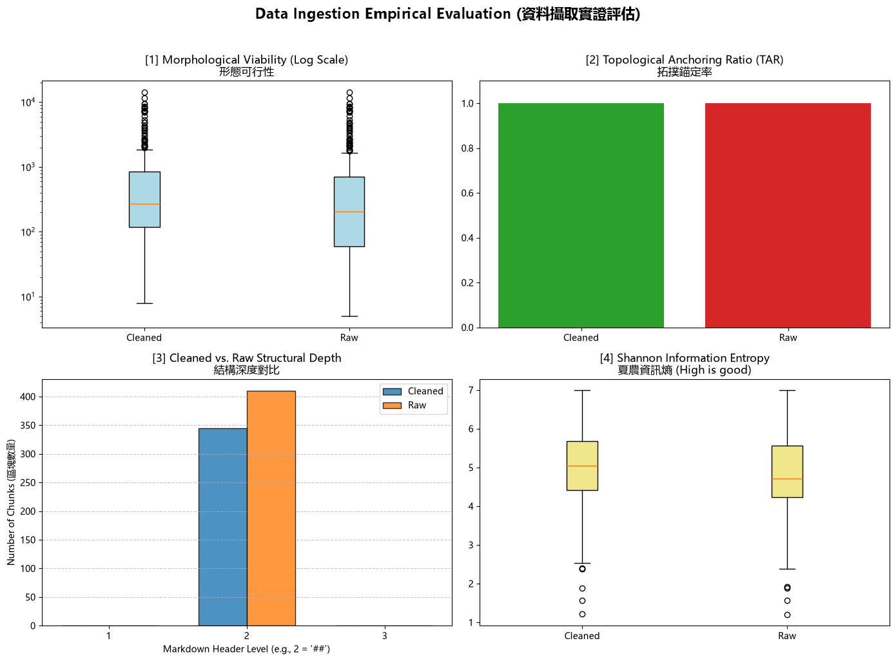

# 資料前處理報告 (Data Preparation Report)

> 期中評量 · NLP 自然語言處理 115-S1
> 填寫方式：請把所有「（ ）」與 `___` 替換成你自己的內容，並刪除 `>` 開頭的說明文字。

- **學號 / 姓名**：u12627037 / 劉芳境
- **專案名稱**：u12627037
- **完成的任務**：- [x] 1-A 頁首頁尾清除　- [x] 1-B 雙語標題合併　- [x] 1-C 雙語條文合併

---

## 1. 資料集概覽 (Dataset Overview)

> 數字來源：`01_Data_Ingestion.ipynb` 第 2 節 (掃描 PDF) 與第 5 節 (批次處理) 的輸出。

| 類別 (Cluster) | PDF 數量 | 清洗前 chunk 數 | 清洗後 chunk 數 |
|Library_information|6  |200|185|
|Academic_Affairs   |6 |43 |21 |
|student_Affairs    |6 |115 |91 |
| **合計** |18|358|297|

**問題 (2–3 句)：** 清洗後 chunk 數量變少了多少？是哪個任務造成的？有沒有哪個任務**不影響** chunk 數量？為什麼？

> 提示：chunk 是用什麼規則切開的？請看 notebook 第 5 節的 `chunking_regex`。

清洗過後chunk從358變少到297。減少來自於1-A與1-B的任務，notebook第五節會在每個##標題面前切一刀，1-A切掉了##開頭前溢出的行，1-B將中英文標題的##合併成一個，所以chunk減少了。1-C合併的事 - 的條文。
___

## 2. 清洗步驟 (Cleaning Steps)

> **截圖來源：** `data/interim/<類別>/` 中的 `raw_*.md` (清洗前) 與 `cleaned_*.md` (清洗後)，也就是批次處理存下的**真實檔案**。
>
> **[重要] 不可使用 notebook 中的範例。** notebook 任務 1-A、1-B、1-C 的測試文字 (第二十一條、明志科技大學 / Ming Chi University of Technology、第十五條 / Article 15) **不能**作為你的截圖。請在真實檔案中**另找一處**，可以是其他 PDF 的檔案。使用範例的截圖**不給分**。
>
> **截圖方法 (VS Code 比較檢視)：**
> 1. 在檔案總管對 `raw_<檔名>.md` 按右鍵 → **Select for Compare**。
> 2. 對同一份文件的 `cleaned_<檔名>.md` 按右鍵 → **Compare with Selected**。
> 3. 左右並排顯示，紅色 = 刪除，綠色 = 新增或修改。按 `Ctrl + F` 搜尋，找到該任務造成的變更。
> 4. 每個任務截**一張**圖，存到 `reports/figures/`，**檔名必須完全相同** (否則圖片不會顯示)：
>    * 任務 1-A → `1a_compare.png`
>    * 任務 1-B → `1b_compare.png`
>    * 任務 1-C → `1c_compare.png`

### 2.1 任務 1-A：頁首頁尾溢出清除

- 檔名：data/interim/Academic_Affairs/raw_A231060004_學生申請期中停修課程實施要點.md / cleaned_A231060004_學生申請期中停修課程實施要點.md　搜尋的文字：學生申請期中停修課程實施要點
- 截圖 (存為 `reports/figures/1a_compare.png`)：
- 改變了什麼：55 行的「學生申請期中停修課程實施要點」與第59行的 ## 學生申請期中停修課程實施要點，都是整行只有法規名稱，清洗後兩行都被刪除，第七條的內文和後面的段落沒有被改動，內文中其他文字也都保留。
- 這對之後的問答檢索有什麼幫助：減少只有法規名稱、沒有實質內容的假 chunk，也避免頁首文字混進條文，讓檢索結果更乾淨。
- 這個任務有沒有**改錯**的地方 (把不該改的也改了)？若有，寫出檔名與搜尋的文字；若沒有，寫「沒有發現」：沒有

### 2.2 任務 1-B：雙語標題合併

- 檔名：data/interim/Library_Information/raw_A271010023_圖書館管理作業規範.md / cleaned_A271010023_圖書館管理作業規範.md　搜尋的文字：Chapter 2 Collection Policy
- 截圖 (存為 `reports/figures/1b_compare.png`)：
- 改變了什麼：原本「## 第二章 館藏政策」和「## Chapter 2 Collection Policy」是兩個獨立的 ## 標題，清洗後合併成一行「## 第二章 館藏政策 / Chapter 2 Collection Policy」，第二個##標題被拿走，內文並沒有做變動
- 這對之後的問答檢索有什麼幫助：避免只出現一個中文的空標題，將中英文標題合併，在檢索時可以同時使用中英文都可以檢索到
- 這個任務有沒有**改錯**的地方 (把不該改的也改了)？若有，寫出檔名與搜尋的文字；若沒有，寫「沒有發現」：沒有發現。

### 2.3 任務 1-C：雙語條文合併

- 檔名：data\interim\Academic_Affairs\raw_A232020018_大學部學則.md" / data\interim\Academic_Affairs\cleaned_A232020018_大學部學則.md"　搜尋的文字：Article 6 Admitted
- 截圖 (存為 `reports/figures/1c_compare.png`)：
- 改變了什麼：中文段落和第 73 行以「- 」開頭的英文條文原本分開，清洗後英文條文接到中文段落後面，中間以「 / 」連接，英文條文前的「- 」被拿掉。
- 這對之後的問答檢索有什麼幫助：同一條的中英文放在同一段，用中文或英文提問都能找到完整的條文。
- 這個任務有沒有**改錯**的地方 (把不該改的也改了)？若有，寫出檔名與搜尋的文字；若沒有，寫「沒有發現」：沒有

## 3. 評估指標與 AI 解讀查證 (Metrics & Verifying the AI's Interpretation)

### 3.1 指標數據表

> 數字來源：專案根目錄的 `metrics.json`。[1]、[2] 必填；[3]、[4] 選填。
> 「參考值」由老師在課堂上公布 (完成全部任務的結果)。

| 指標 | Raw | Cleaned (你的) | Cleaned (參考值) |
|---|---|---|---|
| [1] 中位數長度 Median Length 270.5| 205.0| 273.0| 205.0|
| [2] 拓撲錨定率 TAR 1.0 | 1.0| 1.0| 1.0|
| [3] 深度變異量 SDV (選填) 0.0| 0.0| 0.0| 0.0|
| [4] 中位數資訊熵 Entropy (選填) | | | |

> **儀表板截圖：** 你自己的 `01_Data_Ingestion.ipynb` **第 6 節**輸出的 4 拼圖儀表板 (第 8 週執行並保留的輸出)。截圖後存為 `reports/figures/dashboard.png`。第 3.2 節也會用到這張截圖。

dashboard.png
你的 Cleaned 結果與參考值一致嗎？若一致，寫「一致」；若不一致，找出原因。（1 句）

不一致，Raw 相同但 Cleaned 為 273.0，我的 1-B 把不相關的標題也合併了使短 chunk 變少、中位數變大。
___

### 3.2 AI 的解讀

> 把第 3.1 節的儀表板截圖 (`dashboard.png`) 交給 AI，請它解讀結果。將 AI 的回答**完整貼在這裡**，並註明使用的 AI 工具。

- 使用的 AI 工具：claude

清洗後中位數長度從 205 提高到 273、chunk 數從約 410 減到約 345，代表過短的空標題 chunk 被合併或刪除了；但超過 2,000 字的過長 chunk 仍然存在。TAR 前後都是 100%，是因為切塊規則只在 ## 前切開，這個指標看不出清洗效果。SDV 為 0，表示所有標題都被轉成 ## 同一層，原本的章、條階層沒有保留。中位數資訊熵從 4.72 提高到 5.05，資訊更飽和；但熵低於 2 的離群值多半是空白表格，清洗沒有處理到。

### 3.3 你的查證 (至少兩點)

> 挑 AI 說得最肯定的兩句話，回到你的檔案或程式中找證據：它說的是真的嗎？

**查證 1**
- AI 的說法：TAR 前後都是 100%，是因為切塊規則只在 ## 前切開，這個指標看不出清洗效果。
- 我查了什麼 (哪個檔案、哪個 chunk、哪段程式)：data\interim\Library_Information\cleaned_A273060005_學生電子郵件帳號管理要點.md"。
## Guidelines on Student Email Account Management

制定部門：圖書資訊處

Regulatory Agency：Office of Library and Information Services
- 結論：正確 / 部分正確 / 錯誤，因為：正確。

**查證 2**
- AI 的說法：熵低於 2 的離群值多半是空白表格。
- 我查了什麼：cleaned_A232060013_學生抵免學分辦法.md 第 315 行，熵 1.57。
- 結論：正確 / 部分正確 / 錯誤，因為 部分正確，因為我查的這個 chunk 確實是幾乎只有 | 和空白的空白申請表。
### 3.4 實際證據：你被指定的 chunk

> 執行 `09_midterm_chunks.ipynb`：填入你的學號與老師在課堂上公布的 SEED，按 Run All。
> 每位同學拿到的 chunk 不同。請**連同驗證碼**一起填入。
> 程式只顯示前 400 字元的預覽。請在 VS Code 打開程式列出的**閱讀用檔案** (`data/interim/` 中的 `cleaned_*.md`，與 JSON 內容相同但有正常換行)，按 `Ctrl + G` 輸入程式給的**行號** (或按 `Ctrl + F` 搜尋「搜尋用」文字)，從該行讀到下一個 `## ` 標題為止，就是**完整**的 chunk。

- **SEED**：1106

**(a) 很長的 chunk**
- 資料檔 (JSON)：data/processed/Library_Information/cleaned_A271010023_圖書館管理作業規範_processed.json　位置：第 70 個 (從 0 開始數)　長度：4174 字元　驗證碼：b751a6b7
- 閱讀用檔案 (`.md`)：686　從第 722 行開始
- 前 3 行內容：

## Article 25 Preliminary Review

1. Unit Recommendation Points: Based on the survey results, the library calculates the "unit recommendation points" by referring to the

"Comparison Table of Unit Recommendation Points in Database" (Form No. A071010522) [See Attachment 5]. If the estimated unit price of the electronic database is higher than one fourth of the annual budget of the electronic databa
- 這是什麼樣的文字？為什麼會這麼長？___
- 之後做問答檢索時，這麼長的 chunk 可能造成什麼問題？___

**(b) 資訊熵很低的 chunk**
- 資料檔 (JSON)：data/processed/Academic_Affairs/cleaned_A232060013_學生抵免學分辦法_processed.json　位置：第 28 個 (從 0 開始數)　資訊熵：1.57　驗證碼：eb1f3aac
- 閱讀用檔案 (`.md`)：　從第 315 行開始
- 內容：
 ## 學年度第 學期

| 系所(學 位學程)      |                      |                      |                      | 班級                 |                      |                      |                      | 學號     
- 為什麼它的資訊熵這麼低？它對問答檢索有用嗎？___

## 4. 一個尚未解決的問題 (One Remaining Problem)

> 打開 `data/interim/` 中任一個 `cleaned_*.md` (與 `data/processed/` 的 JSON 內容相同，但有正常換行，比較好讀)，找出一個清洗後**仍然有問題**的 chunk。
> 每個 chunk 從一個 `## ` 標題開始，到下一個 `## ` 標題之前結束。
> 例如：只有標題沒有內文、表格亂掉、中英文沒有對齊、還有殘留的頁首頁尾、斷行造成的多餘空白，或是**清洗造成的錯誤** (誤合併、誤刪除)。
> **不可**使用第 3.4 節的兩個 chunk。

- **檔名** (`cleaned_*.md`)：data\interim\Library_Information\cleaned_A271010023_圖書館管理作業規範.md"　**從第 47 行開始** (VS Code 左側的行號)　**標題**：___
- **我是怎麼找到的** (例如：搜尋了什麼、看了哪個檔案)：在執行轉換時有跳出警告
- **問題 chunk (貼上部分內容)**：

|          |                                                                                                    | 頁次                                                                                                |
|----------|----------------------------------------------------------------------------------------------------|-----------------------------------------------------------------------------------------------------|
| 第一章   | 總則                                                                                               | ................................................................................................. 1 |
| 第二章   | 館藏政策 ......................................................................................... | 3                                                                                                   |
| 第三章   | 圖書、非書資料、期刊及資料庫預算作業 .................................                             | 5                                                                                                   |
| 第四章   | 圖書介購、訂購及驗收付款 .........................................................                 | 9                                                                                                   |

- **問題是什麼**：這個 chunk 是文件的「目次」，Docling 把它轉成 Markdown 表格，內容只有章名、大量的「......」引導點和頁碼，沒有任何實際規定；目次後面的「Chapter 1 General Principles」也沒有被轉成 ## 標題
- **可能的原因** (PDF 本身？Docling 轉換？清洗的正則表示式？切塊規則？)：PDF 本身有目次頁，Docling 把它當成表格轉換；清洗的正則只處理頁首、雙語標題與條文，沒有處理目次。
- **具體的修正方法** (例如：一條規則、一個正則表示式的構想、長度上限)：新增一條清洗規則，刪除含有連續 5 個以上「.」引導點的行，或在切塊後把「. 和 | 佔比過高」的 chunk 過濾掉，不放進檢索資料。
- **對問答檢索的影響**：目次同時出現所有章名問問題時這個chunk 很可能因為章名相符而被排在前面，但它只有頁碼、沒有答案，會擠掉真正有內容的第二章 chunk。

## 5. AI 協作 (AI Collaboration)

- 本次作業的 AI 協作紀錄請見 [`AI_USAGE.md`](AI_USAGE.md) 的「Week 04 / 08」與「Week 09」段落。
- 這次使用 AI 最大的收穫或教訓是 ___（請具體：例如提示詞中哪一段最關鍵、AI 哪一句解讀不正確）
